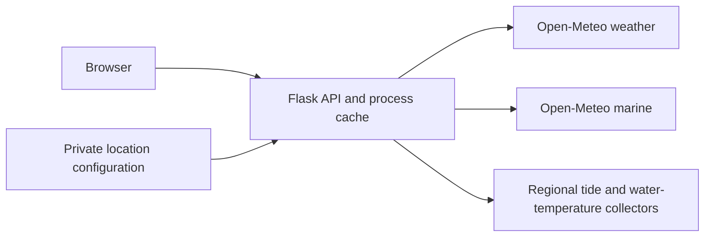

# BeachWatch

[](https://github.com/jealrodos/beach-dashboard/actions/workflows/ci.yml)

A self-hosted dashboard that brings beach weather, tides, wind, waves and
water-temperature sources into one compact screen. It was developed with AI
assistance for a personal homelab and is part of the Atria ecosystem. The
interface shares Atria's Solarized dark theme, bold Othala rune and
self-hosted lowercase Josefin Sans wordmark. The font licence is included in `static/atria`.
The cream **beachwatch** title uses heavier “beach” and lighter “watch”, with
the parent signature on the right. The updated timestamp sits below the table
at the bottom right. See the [brand specifications](docs/BRAND.md).
Its header uses the waves vector. `static/app-icons/beach` includes SVG/PNG
favicons, an opaque Apple 180px PNG, 192/512px PWA icons and a standalone
manifest. Links remain portable and served by this deployment.

The repository contains the authored application, interface, configuration
examples and deployment template. Frameworks and external data services remain
upstream dependencies.

## Run with Docker

```sh
cp .env.example .env
docker compose up -d --build
```

Open `http://127.0.0.1:8787`. The default binding is local to the computer running
Docker. Configure an appropriate address and your own access controls if the
dashboard should be reachable from other devices.

To use your own locations, copy `beaches.example.json` to `beaches.local.json`
and set `BEACH_CONFIG_PATH=./beaches.local.json` in `.env`. Personal locations and
the actual home-navigation URL stay outside Git. Restart the application after
changing location configuration. `HOME_URL` supplies the destination of the Atria signature.

## Data flow



Weather for the configured locations is requested in a batch. Other collectors
run concurrently, and successful dashboard responses are cached for 60 seconds
by default. The Docker deployment uses one Gunicorn worker with four threads.

## Regional scope and limits

The collectors were built for locations in Portugal and Spain. The `sea` type
uses the configured coordinates for marine predictions. The `douro`, `lake`
and `limens` types select the existing regional water-temperature collectors;
they are not generic providers for arbitrary rivers, lakes or coastlines.
The tide collector and its displayed regional label also need adaptation when
using another region.

Some providers are scraped pages and can change without notice. A location can
report a partial error, while failure of the shared weather request currently
returns an API error. The cache is local to the process, and simultaneous cache
misses can still repeat upstream work. `/health` reports application liveness,
not the freshness or completeness of every provider.

Data comes from [Open-Meteo](https://open-meteo.com/),
[AEMET](https://www.aemet.es/), [Tidecheck](https://tidecheck.com/) and
[SeaTemperature.net](https://seatemperature.net/). Review each provider's terms,
attribution requirements and usage limits for your deployment.

## API and validation

- `GET /` renders the dashboard.
- `GET /api/beaches` returns the collected conditions.
- `GET /health` reports liveness and the deployed Git revision when provided.

```sh
python -m pip install -r requirements.txt
python -m unittest discover -s tests -v
```

Tests use fixtures rather than calling live weather services. Production releases
should build from a clean Git revision and set `ATRIA_GIT_SHA` to that revision;
the image label and health response then provide a traceable deployment identity.

`python tools/check_secrets.py` runs a checksum-pinned
[Gitleaks](https://github.com/gitleaks/gitleaks/releases/tag/v8.30.1) scan. The
GitHub workflow runs the fixtures and source scan on pushes and pull requests.
Keep production configuration outside the repository; a clean scanner result
does not replace reviewing the files selected for publication.
